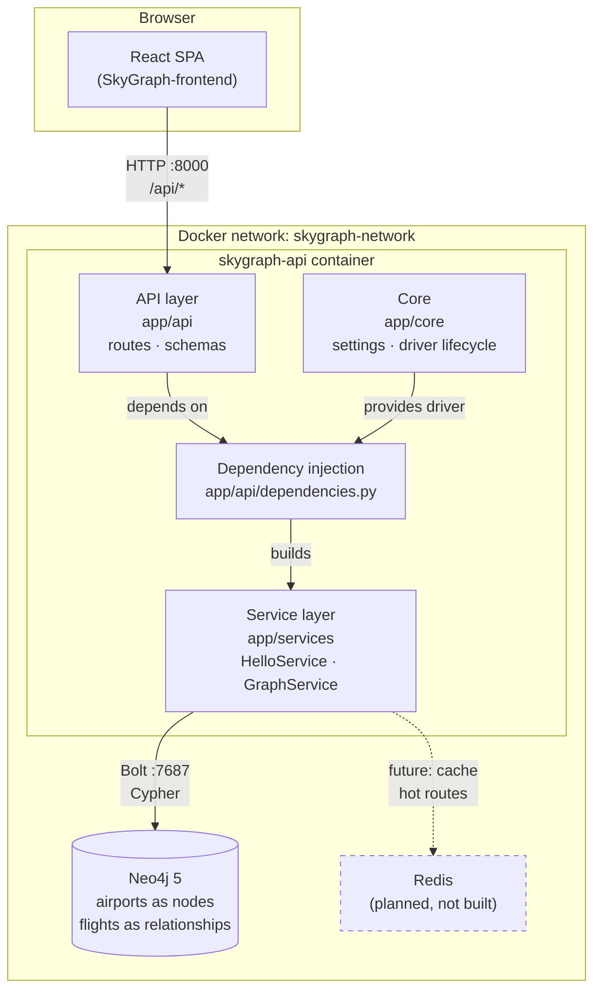

# SkyGraph — Backend

FastAPI service that computes the **cheapest flight route between two airports**
using a Neo4j graph database.

Part of the SkyGraph system:

| Repository                                                                          | Role                            |
| ----------------------------------------------------------------------------------- | ------------------------------- |
| [SkyGraph-frontend](https://github.com/ProjetoIntegrador3b/SkyGraph-frontend)         | React single-page application   |
| **SkyGraph-backend** (this repo)                                                      | REST API + graph database       |

---

## What the system does

The user supplies an **origin** airport, a **destination** airport and the travel
dates. The API searches the flight graph and returns the **single cheapest route**
between them — which is not necessarily the shortest one in kilometres.

Airports are modelled as **nodes** and flights as **relationships** between them, so
"find the cheapest route" becomes a weighted graph traversal — the problem Neo4j is
built for, and the reason it was chosen over a relational database. Expressing the
same query in SQL would require an arbitrary number of self-joins, one per
connection.

### Route weight

**Price is the only weight.** A route is scored on total ticket cost and nothing
else:

| Weight | Meaning                           |
| ------ | --------------------------------- |
| Price  | Total ticket cost across all legs |

The number of connections and the travel dates are returned alongside the route
as information about it, but they take **no** part in the scoring: the cheapest
route wins even when it has more stops or takes longer.

Only flights that **depart and arrive within the travel period** are used, and a
connecting flight must depart on or after the day the previous one arrives.

---

## Tech stack

| Layer          | Choice                          | Notes                                                     |
| -------------- | ------------------------------- | --------------------------------------------------------- |
| Language       | Python 3.13                     |                                                           |
| Web framework  | FastAPI 0.141                   | Async, with generated OpenAPI docs                        |
| Server         | Uvicorn 0.52                    | ASGI server                                               |
| Database       | Neo4j 5 (Community)             | Graph database holding airports and flights               |
| Driver         | `neo4j` 6.3 (async)             | Official driver, connection-pooled                        |
| Settings       | pydantic-settings 2.15          | Environment-based configuration                           |
| Tests          | pytest 9 + httpx                | ASGI transport, no live server needed                     |
| Lint + format  | Ruff 0.16                       | Replaces flake8/isort/black in one tool                    |
| Container      | Docker + Docker Compose         | API and database both containerised                       |

**Planned:** a Redis cache for frequently requested routes, so popular
origin/destination pairs skip the graph traversal entirely. Not implemented yet.

---

## Architecture



### Request flow

1. A route handler declares the service it needs (e.g. `FlightServiceDep`).
2. FastAPI resolves that through the providers in `app/api/dependencies.py`, which
   build the repository from the Neo4j driver on app state and hand it to the service.
3. The repository runs the Cypher query and returns domain models.
4. The service applies the use case — e.g. raising `NotFoundError` (404) or
   `MissingReferenceError` (422), which the app turns into responses — and the
   handler shapes the models into response schemas.

Handlers never touch the driver directly. That indirection is what lets the test
suite swap in a fake graph service and run **without a database**.

### Layout

```
app/
├── api/
│   ├── dependencies.py   # DI providers — the seam used by tests
│   ├── routers/          # One router per resource: airports, flights, routes
│   ├── routes.py         # Hello + health handlers; includes the routers
│   └── schemas.py        # Pydantic request/response models (camelCase JSON)
├── core/
│   ├── config.py         # Settings loaded from the environment
│   └── neo4j.py          # Driver creation and lifecycle
├── migrations/           # Versioned Neo4j migrations, applied on startup
│   ├── runner.py         # MIGRATIONS list + run_migrations()
│   └── m000N_*.py        # One file per migration
├── models/
│   ├── airport.py        # Airport — graph node, keyed by IATA code
│   ├── filters.py        # Query filters for the list endpoints
│   ├── flight.py         # Flight — priced relationship between airports
│   ├── route.py          # RouteSearch (request) and Route (chain of flights)
│   └── pagination.py     # PageParams (page, pageSize) and Page
├── repositories/         # The only data access
│   ├── base.py           # BaseRepository — generic get/get_all/create/update/delete
│   ├── airport.py        # AirportRepository — Airport nodes
│   ├── flight.py         # FlightRepository — FLIGHT relationships
│   └── route.py          # RouteRepository — cheapest-route Cypher search
├── services/
│   ├── base.py           # BaseService — generic get/get_all/create/update/delete
│   ├── airport.py        # AirportService
│   ├── errors.py         # ServiceError and subclasses, mapped to their status codes
│   ├── flight.py         # FlightService
│   ├── route.py          # RouteService — route search
│   ├── graph.py          # GraphService — connectivity check
│   └── hello.py          # HelloService
└── main.py               # create_app() + lifespan
initial_data_csv/         # Seed data: aeroportos.csv, voos.csv
tests/                    # pytest suite, database-free
```

### Driver lifecycle

The Neo4j driver is connection-pooled and expensive, so **exactly one** is created
per process: built in the FastAPI `lifespan` on startup, stored on app state, closed
on shutdown.

Creating the driver does **not** open a connection. The API therefore starts
successfully even when Neo4j is not ready yet, and reports the problem through
`/api/health` instead of crash-looping.

### Graph data and migrations

Airports are `(:Airport {code, name, city, country, latitude, longitude})` nodes,
keyed by IATA code. Flights are
`(:Airport)-[:FLIGHT {uuid, price, departure_date, arrival_date}]->(:Airport)`
relationships, keyed by `uuid`. The two days are Neo4j `DATE` values; a flight
arrives on its departure day or later.

The data comes from `initial_data_csv/aeroportos.csv` and
`initial_data_csv/voos.csv`. Alembic does not support Neo4j, so the project uses a
small migration runner in `app/migrations`:

| Migration                   | What it does                                          |
| --------------------------- | ----------------------------------------------------- |
| `0001_constraints`          | Uniqueness constraints on `Airport.code`, `FLIGHT.uuid` |
| `0002_airports_and_flights` | Validates both CSVs through the models and loads them |
| `0003_flight_dates`         | Sets each flight's `departure_date` and `arrival_date` from `voos.csv` |

- **When they run:** on every API startup, so a fresh deploy gets its data. If
  Neo4j cannot be reached, the error is logged, the API starts anyway, and the
  migrations are retried on the next start. Set `MIGRATE_ON_STARTUP=false` to
  turn this off.
- **By hand:** `.venv/bin/python -m app.migrations`.
- **Run once:** each applied migration is recorded as a `(:SchemaMigration {id})`
  node and skipped afterwards. Migrations use `MERGE` and `IF NOT EXISTS`, so
  re-running one after a partial failure is safe.
- **Changing data or schema:** add a new `m000N_*.py` file and append it to
  `MIGRATIONS` in `runner.py`. Do not edit an applied migration — it will not run
  again. Editing the CSVs alone therefore changes nothing in an existing database.

---

## Endpoints

| Method | Path          | Description                                                     |
| ------ | ------------- | --------------------------------------------------------------- |
| GET    | `/api/hello`  | Hello world — returns `{"message": "Hello SkyGraphers"}`         |
| GET    | `/api/health` | Neo4j connectivity; `200` when reachable, `503` when not         |
| GET    | `/api/airports` | Airports, sorted by code; paginated and filterable (below)     |
| GET    | `/api/airports/{code}` | One airport by IATA code (any case); `404` if unknown   |
| GET    | `/api/flights` | Flights, cheapest first; paginated and filterable (below)       |
| GET    | `/api/flights/{uuid}` | One flight by uuid; `404` if unknown                     |
| POST   | `/api/routes` | Cheapest route between two airports in a period (below)         |

Interactive OpenAPI docs: **http://localhost:8000/docs**

### Pagination

The list endpoints return one page at a time:

| Parameter  | Default | Meaning                              |
| ---------- | ------- | ------------------------------------ |
| `page`     | `1`     | Page number, starting at 1           |
| `pageSize` | `50`    | Items per page, from 1 to 200        |

```json
{
  "items": [{ "uuid": "…", "price": 302.01, "origin": "GRU", "destination": "GIG" }],
  "page": 1,
  "pageSize": 50,
  "total": 400
}
```

`total` counts the matching items across all pages, after filters. A page past
the end returns an empty `items` list.

### Filters

All filters are optional query parameters and can be combined with each other and
with `page`/`pageSize`; an unknown or invalid one returns `422`.

| Endpoint        | Parameter     | Matches                                         |
| --------------- | ------------- | ----------------------------------------------- |
| `/api/airports` | `city`        | Exact city name, ignoring case                  |
| `/api/airports` | `country`     | Exact country name, ignoring case               |
| `/api/flights`  | `minPrice`    | Price at or above the value                     |
| `/api/flights`  | `maxPrice`    | Price at or below the value; not below `minPrice` |
| `/api/flights`  | `origin`      | IATA code of the departure airport (any case)   |
| `/api/flights`  | `destination` | IATA code of the arrival airport (any case)     |

```bash
curl 'http://localhost:8000/api/flights?origin=GRU&maxPrice=1000&page=2&pageSize=20'
```

### Route search

| Method | Path          | Description                               |
| ------ | ------------- | ----------------------------------------- |
| POST   | `/api/routes` | The cheapest route for the search         |

A **single** endpoint serves the whole search. There is no parameter for choosing
a weight, because price is the only one.

Request — `departureDate` and `returnDate` delimit the travel period:

```json
{
  "origin": "GRU",
  "destination": "GIG",
  "departureDate": "2027-01-10",
  "returnDate": "2027-01-20"
}
```

Response — `route` is `null` when no route fits the search:

```json
{
  "route": {
    "price": 984.95,
    "connections": 1,
    "departureDate": "2027-01-11",
    "arrivalDate": "2027-01-13",
    "legs": [
      { "uuid": "…", "price": 682.94, "origin": "GRU", "destination": "FOR",
        "departureDate": "2027-01-11", "arrivalDate": "2027-01-11" },
      { "uuid": "…", "price": 302.01, "origin": "FOR", "destination": "GIG",
        "departureDate": "2027-01-12", "arrivalDate": "2027-01-13" }
    ]
  }
}
```

How the route is chosen:

- Only flights that depart on or after `departureDate` and arrive on or before
  `returnDate` are used.
- Each connecting flight departs on or after the day the previous one arrives.
- The route with the lowest total price wins; ties go to fewer flights, then the
  earliest arrival.
- Routes have at most 4 flights (3 connections), which bounds the search.

The search is a single Cypher query (`app/repositories/route.py`): a quantified
path pattern walks only the flights inside the period, so Neo4j never expands a
flight that could not be used.

Errors: an unknown airport returns `404`; the same airport twice, a `returnDate`
before `departureDate`, or a missing field returns `422`.

---

## Running with Docker (recommended)

The network is shared with the frontend stack, so create it once:

```bash
docker network create skygraph-network
docker compose up -d --build
```

| Service       | URL                     |
| ------------- | ----------------------- |
| API           | http://localhost:8000   |
| OpenAPI docs  | http://localhost:8000/docs |
| Neo4j Browser | http://localhost:7474   |
| Neo4j Bolt    | `bolt://localhost:7687` |

Neo4j credentials: `neo4j` / `skygraph`.

Compose starts Neo4j first and waits for its healthcheck before starting the API.
Graph data lives in named volumes and survives `docker compose down`; add
`--volumes` to wipe it.

### Port conflicts

If a default port is already taken on your machine, override it:

```bash
API_PORT=8010 docker compose up -d
```

`API_PORT`, `NEO4J_HTTP_PORT` and `NEO4J_BOLT_PORT` are all overridable. See
`.env.example`.

---

## Running locally (without Docker)

Neo4j still needs to be running — start just that container with
`docker compose up -d neo4j`.

```bash
uv venv --python 3.13
uv pip install -e ".[dev]"

.venv/bin/uvicorn app.main:app --reload
```

Configuration comes from the environment; copy `.env.example` to `.env` and adjust.

| Variable         | Default                 | Meaning                    |
| ---------------- | ----------------------- | -------------------------- |
| `NEO4J_URI`      | `bolt://localhost:7687` | Database address           |
| `NEO4J_USER`     | `neo4j`                 | Username                   |
| `NEO4J_PASSWORD` | `skygraph`              | Password                   |
| `NEO4J_DATABASE` | `neo4j`                 | Database name              |
| `MIGRATE_ON_STARTUP` | `true`              | Apply pending migrations when the API starts |
| `SEED_DATA_DIR`  | `initial_data_csv`      | Folder holding the seed CSVs, relative to the working directory |

### CORS

Browsers block cross-origin calls unless the API names the origins it trusts.

| Variable            | Default                                                        | Meaning                             |
| ------------------- | -------------------------------------------------------------- | ----------------------------------- |
| `CORS_ORIGINS`      | localhost:5173, localhost:3000, `https://sky-graph-frontend.vercel.app` | Comma-separated allowed origins |
| `CORS_ORIGIN_REGEX` | matches `sky-graph-frontend-*.vercel.app`                       | Allows Vercel preview deployments   |

Credentials are disabled (`allow_credentials=False`) because the API uses no
cookies or auth headers. When authentication is added, enable them and keep the
origin list exact.

---

## Development

```bash
.venv/bin/pytest              # run the test suite
.venv/bin/ruff check .        # lint
.venv/bin/ruff format .       # format
.venv/bin/ruff format --check .  # verify formatting without writing
```

### Tests

The suite uses FastAPI's `dependency_overrides` to replace `GraphService` with a
fake, so tests are fast and need no database. Coverage includes the hello endpoint,
the health endpoint in its reachable / unreachable / driver-raises states, the
DI providers themselves, the airport and flight routes, services and
repositories, and the migration runner against a fake driver. The CI
Docker job checks the migrations against a real Neo4j.

---

## Continuous integration

`.github/workflows/ci.yml` runs on every pull request to `main`:

| Check                | Blocks merge?                             |
| -------------------- | ----------------------------------------- |
| `ruff format --check`| **No** — warns only, annotating the files |
| `ruff check`         | **Yes**                                   |
| `pytest`             | **Yes**                                   |
| Docker stack builds  | **Yes** — boots Compose and smoke-tests the API against a real Neo4j |

Formatting is intentionally advisory: it reports unformatted files as PR
annotations, but never blocks the merge.

## Deployment

The API is deployed on [Render](https://render.com) from the `Dockerfile`. The
container binds to `$PORT` when the host provides one and falls back to `8000`
locally, so the same image runs in both places.

Deploys are **release-triggered, not push-triggered**: Auto-Deploy is off on the
Render service, and `.github/workflows/deploy.yml` calls a Render deploy hook
when a GitHub Release is published. The hook is pinned to the released commit,
so merging to `main` never ships anything on its own.

```bash
gh release create v0.1.0 --generate-notes
```

Pre-releases (`v0.1.0-rc1`) are skipped by the workflow.

Required repository secret:

| Secret                   | Where to find it                                  |
| ------------------------ | ------------------------------------------------- |
| `RENDER_DEPLOY_HOOK_URL` | Render service → Settings → Deploy Hook (a secret) |

Set the Render health check path to `/api/hello`, not `/api/health` — the latter
returns 503 when Neo4j is unreachable, which would fail an otherwise healthy
deploy.
